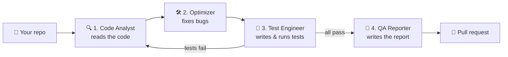

# QA AI Agent System

**An AI QA team that checks your code, fixes it, tests it, and writes up what it did.**

🌐 **Website:** [professor-jo.github.io/qa-agentic-system](https://professor-jo.github.io/qa-agentic-system/)

Point it at a GitHub repository or a folder on your computer. Four AI agents
read the code, fix the bugs they find, write and run tests, and write a report.
Everything they change is put on a separate branch with a pull request, so you
can review it before anything reaches your main branch.

It works with **Python** and **JavaScript / TypeScript** projects, including
React apps, and with projects that have both, such as a Python backend and a
React frontend.

---

## How it works



| Step | Agent | What it does |
|:----:|-------|--------------|
| 1 | 🔍 **Code Analyst** | Reads the whole project and lists the problems it finds |
| 2 | 🛠️ **Optimizer** | Fixes those bugs and inefficiencies, then suggests modern UI ideas and libraries (suggestions only, not applied) |
| 3 | 🧪 **Test Engineer** | Writes tests and runs them. If any fail, the failures go back to steps 1 and 2 to be fixed, and the tests run again until they all pass |
| 4 | 📝 **QA Reporter** | Writes a report of everything that was found, fixed and tested |

Finally, everything is committed to a new branch, and a **pull request** is
opened for you to review.

---

## What it looks like

While it runs, a live dashboard shows each agent and what it's doing right now:

```
╭─ Agentic QA · https://github.com/you/my-app @ main ────────────────────────────╮
│ ✓  Setup              backend (python), frontend (js) · 1m 22s                  │
│ ✓  1 · Code Analyst   2m 17s                                                    │
│ ◰  2 · Optimizer      [=== ]  editing backend/app/routes/auth.py · 41s          │
│ ·  3 · Test Engineer                                                            │
│ ·  4 · QA Reporter                                                              │
│ ·  Branch & PR                                                                  │
│ activity ────────────────────────────────────────────────────────────────────── │
│ 14:02:11  Code Analyst   reading backend/app/services/llm.py                    │
│ 14:02:40  Optimizer      editing backend/app/routes/auth.py                     │
╰─────────────────────────────────────────────────────────────────────────────────╯
```

When it finishes, you get the result and a plain list of everything that changed:

```
SUCCESS  All tests pass and the work is on its own branch.
  PR      https://github.com/you/my-app/pull/1
  Usage   2.0M in (1.5M cached) / 150k out · ≈ $1.16 (gpt-5.4-mini)

╭─ What changed · on branch qa/agentic-20261015-191217 ─────────────────────────╮
│ Code fixed (2 files)                                                           │
│   ✎ backend/app/routes/auth.py   +14 −2   Replaced hard-coded JWT secret      │
│   ✎ backend/app/services/llm.py  +10 −4   Made parsing of model output safer  │
│ Tests added (3 files)  backend: 6 passed; frontend: 2 passed                   │
│   + agentic test/backend/unit/test_llm_parse.py                                │
│   + agentic test/backend/unit/test_trip_prefs.py                               │
│   + agentic test/frontend/unit/test_api_fallback.test.js                       │
│ Reports added                                                                  │
│   + Agentic QA Report/Comprehensive QA report 2026-10-15.md                    │
│   + agentic test/2026-10-15-test-report.md                                     │
╰────────────────────────────────────────────────────────────────────────────────╯
```

If something goes wrong (for example, an install fails or tests keep failing),
it explains the problem and lets you choose what to do next:

```
╭─ Needs your decision ───────────────────────────────────────────╮
│ Tests still fail after 3 fix round(s): backend (2 failed)       │
│   1) Run 3 more fix rounds (default)                            │
│   2) Skip the test report and write the QA report anyway        │
│   3) Stop here and keep the changes                             │
│   4) Stop and discard all changes                               │
╰─────────────────────────────────────────────────────────────────╯
```

---

## Quick start

**1. Install** (you need Python 3.11–3.13, Git, and Node.js for JavaScript projects)

```bash
git clone https://github.com/professor-jo/qa-agentic-system.git
cd qa-agentic-system
python3.12 -m venv .venv
source .venv/bin/activate
pip install -e .
```

**2. Run it**

```bash
qa_team
```

**3. Add your own OpenAI API key.** The app runs on your key, not the
developer's. In the web app, the first screen shows a **Step 1** box for it; in
the terminal you're asked once. It's saved only on your computer. Get a key at
[platform.openai.com/api-keys](https://platform.openai.com/api-keys).

**4. Tell it which project to check.** Type a folder path or a GitHub URL, or
press Enter to pick from your GitHub repositories:

```
Which repository should the team work on? Enter one of:
  • a local folder path   e.g. ~/projects/my-app
  • a GitHub URL          e.g. https://github.com/owner/repo
  • nothing (just press Enter) to pick from your GitHub repositories

Folder path or GitHub URL: ~/projects/my-app
```

A run usually takes **10 to 15 minutes** per project.

---

## Prefer a browser? Use the web app

```bash
qa_team ui
```

This opens the app in your browser. It runs only on your computer at
`http://127.0.0.1:8765`; nothing is hosted online. From there you can:

- **pick a project:** paste a GitHub link or drop a project folder onto the
  page. If a link or folder can't be used, a short message explains why
- **watch the run live:** each agent has its own animation, next to a live
  activity feed
- **answer questions with buttons** when the app needs a decision
- **review the result:** expand each changed file to see its diff, read the
  reports, and open the pull request
- **see past runs** and change **settings** (API key, model, speed)

Options: `qa_team ui --port 9000` uses a different port, and `--no-browser`
starts the server without opening a browser tab.

---

## More ways to run it

```bash
qa_team https://github.com/owner/repo         # a GitHub project
qa_team ~/projects/my-app                     # a project on your computer
qa_team ~/projects/my-app --branch dev        # check a specific branch
qa_team --mine                                # pick several of your GitHub repos
qa_team ~/projects/my-app --no-pr             # keep everything local, don't push
```

| Option | What it does |
|--------|--------------|
| `--branch NAME` | Check this branch instead of the current one |
| `--mine` | List your GitHub repos and pick some (`1,3` or `all`) |
| `--no-pr` | Commit to a local branch only, without pushing or opening a pull request |
| `-v` | Show the agents' full output instead of the dashboard |

---

## What you get

Everything goes on a new branch called `qa/agentic-<date>`:

```
your-project/
├── (the files the Optimizer fixed)
├── agentic test/
│   ├── backend/  …                      ← the new tests
│   ├── frontend/ …
│   └── 2026-10-15-test-report.md        ← short test report
└── Agentic QA Report/
    └── Comprehensive QA report 2026-10-15.md   ← the full report
```

- **Your own repo:** a pull request is opened automatically.
- **Someone else's repo:** you can fork it and open a pull request to the
  original project, or just keep the branch locally.
- **Your main branch is never changed.** You review the pull request and
  decide whether to merge it.

---

## Is it safe?

- 🔑 **Your API key stays on your computer**, in a `.env` file that is never
  committed.
- 🌿 **Nothing touches your main branch.** All changes go on a separate branch
  for you to review.
- 🛡️ **Each agent can only do its own job.** The Optimizer can edit source
  code but not tests or dependencies. The Test Engineer can only write inside
  `agentic test/`.
- ↩️ **You can undo everything.** If you stop a run and choose "discard", every
  file is restored exactly as it was.
- ⚠️ **The tests run the project's code on your machine,** so only use it on
  code you trust.

---

## How much does it cost?

You use your own OpenAI API key, so runs are billed to your OpenAI account.
**Every run shows its exact token usage and estimated cost at the end.**

The default model is `gpt-5.4-mini`: fast and affordable. You can change it in
Settings (web app) or with `MODEL=` in your `.env` file:

| Model | Speed | Cost | Good for |
|-------|-------|------|----------|
| `gpt-5.4-mini` (default) | fastest | low | everyday runs |
| `gpt-6-luna` | fast | lowest | big repos on a budget |
| `gpt-6.1-sol` | slower | ~2–3× more | the most thorough fixes |

---

## Requirements

| You need | Why | Install on a Mac |
|----------|-----|------------------|
| Python 3.11–3.13 | runs the app | `brew install python@3.12` |
| Git | everything | `xcode-select --install` |
| Node.js 18+ | testing JavaScript/TypeScript projects | `brew install node` |
| GitHub CLI *(optional)* | listing your repos and opening pull requests | `brew install gh`, then `gh auth login` |
| OpenAI API key | powers the agents | [platform.openai.com/api-keys](https://platform.openai.com/api-keys) |

---

## Learn more

- [docs/WORKFLOW.md](docs/WORKFLOW.md): the detailed step-by-step flow, error
  handling and limits
- Every run saves a full log to `output/<project>/<date>/run.log`

## License

[MIT](LICENSE)
