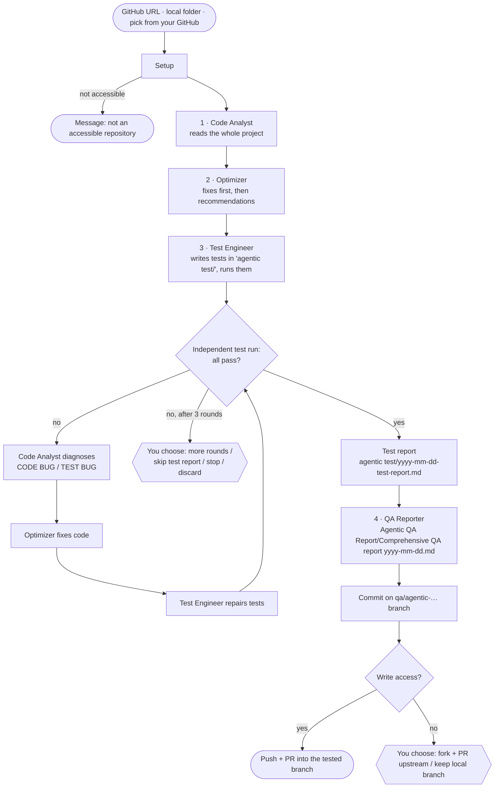

# Agentic QA Workflow

This document walks through what happens when you run `qa_team` on a
repository. Usage is covered in the [README](../README.md).



## Setup

1. **Get the repository.**
   - GitHub URLs are cloned fresh into `workspace/<repo>`. If an earlier clone
     holds QA branches that were never pushed, you're asked before it's replaced.
   - Local folders are used in place. If one has uncommitted changes, you can
     stash them for the run (they're restored at the end), continue, or cancel.
   - Anything that isn't an accessible Git repository stops with a message
     explaining why.
2. **Detect components.** Every folder (up to 3 levels deep) that contains
   `pyproject.toml`, `setup.py`, `setup.cfg` or `requirements.txt` is a Python
   component, and every folder with a real `package.json` is a JS/TS component.
   Each one gets its own test folder: `agentic test/<component>/`.
3. **Install dependencies.**
   - **Python:** a virtualenv in `workspace/.venvs/<repo>/<component>`, with
     the project, its test/dev extras, its `requirements*.txt` and pytest. The
     project's own tests run once to get a baseline.
   - **JS/TS:**
     - The project's dependencies are installed with `npm ci`, or
       `npm install --no-save`. Neither changes the lockfile.
     - A small harness is generated in `agentic test/<component>/`:
       `package.json`, `vitest.config.mjs`, a setup file and `.gitignore`.
     - vitest (plus jsdom and Testing Library for UI projects) is installed
       there, and the project's own React is linked in so there's only one copy.
   - If an install fails, you choose to skip that component, retry or stop.
4. **Check the OpenAI key and model** with one tiny call. If it fails, you
   choose to retry, enter a new key or stop.

## The agents

| Agent | Tools | Task | Output |
|-------|-------|------|--------|
| 1 · Code Analyst | list, read, search | Reads the whole project. Reports the overview, architecture, code quality issues (`path:line`), dated patterns and what to test. | analysis (passed on) |
| 2 · Optimizer | list, read, search, **edit**, create | **Priority 1:** fixes bugs, mistakes and inefficiencies with surgical edits. **Priority 2:** recommends UI/UX and framework/library upgrades (not applied). | changes table + recommendations |
| 3 · Test Engineer | list, read, search, **write test**, run tests | Writes tests in `agentic test/<component>/` (subfolders such as `unit/`, `integration/`, `components/`), covering the analysis and every fix, and runs them. | test files + summary |
| 4 · QA Reporter | none | Writes the comprehensive report from the team's records. | `Comprehensive QA report yyyy-mm-dd.md` |

### The failure loop

After the Test Engineer finishes, the program itself runs every component's
tests. It also re-runs the project's own Python tests if they passed before,
which catches regressions the Optimizer introduced.

If anything fails, the work goes back to the first two agents:

1. The **Code Analyst** diagnoses each failure as a *CODE BUG* or a *TEST BUG*,
   giving the root cause and the fix.
2. The **Optimizer** fixes the CODE BUGs.
3. The **Test Engineer** repairs the TEST BUGs (it may never weaken a correct
   assertion), and everything runs again.

After 3 rounds, you're asked: run more rounds, skip the test report and write
the QA report anyway, stop and keep the changes, or discard everything.

### Reports

- **`agentic test/yyyy-mm-dd-test-report.md`** is written **only when every
  test passes**. It's short: a verdict, a results table, what's covered, and
  the bugs that were caught and fixed.
- **`Agentic QA Report/Comprehensive QA report yyyy-mm-dd.md`** covers the
  whole process: summary, process table, analysis, fixes, recommendations,
  testing rounds and delivery. If the folder exists, only the file is added.

If a report with the same name already exists (a second run the same day),
` (2)` is appended to the new file's name.

## Delivery

1. **Commit** on a new branch `qa/agentic-YYYYMMDD-HHMMSS`. Only the agents'
   work is committed: the changed source files, `agentic test/` (without
   `node_modules`) and `Agentic QA Report/`.
2. **Push and open a PR** into the tested branch, if the active `gh` account
   has push access.
3. **Without push access,** you choose to fork and open a PR upstream (useful
   for helping other developers) or keep the branch locally.
4. **Switch back** to the tested branch. With `--no-pr`, the work is only
   committed locally.

## Errors

Every error is written to `output/<repo>/<timestamp>/run.log`, together with the
suggestions shown and the option you chose. Without a terminal (CI, piped input),
the default option is used automatically and logged.

| Situation | Options |
|-----------|---------|
| Old clone has unpushed QA work | move it aside · delete it |
| Local repo has uncommitted changes | stash during the run · continue · cancel |
| Dependency install fails | skip the component · retry · stop |
| OpenAI key or model rejected | retry · enter a new key · stop |
| An agent errors (rate limit, outage, …) | retry · stop and keep changes · stop and discard |
| Tests still failing after N rounds | more rounds · skip the test report · stop · discard |
| No push access | fork + PR · keep the branch locally |

## Limits

- Python and JavaScript/TypeScript only.
- Tests that need real services (databases, external APIs) must mock them,
  because nothing is started for them.
- Only the project's own **Python** tests are re-run for regressions. JS
  projects' own test scripts (for example Playwright end-to-end tests) are not run.

## Web UI

`qa_team ui` starts a local FastAPI server (`web.py`) and opens the page in
`webui/index.html`. It drives the same `runner.run_repo` as the terminal; the
only difference is the UI object passed in:

| | Terminal (`ui.Dashboard`) | Web (`web.WebRun`) |
|---|---|---|
| Progress | live Rich panel | events streamed to the browser (Server-Sent Events) |
| Decisions | numbered prompt in the terminal | buttons in a dialog; the run waits for the click |
| "What changed" | printed after the run | shown on the page, with a diff per file |

Safety:
- **Your computer only:** the server listens on `127.0.0.1`.
- **A secret token on every API call:** it's generated at startup and embedded
  in the page, so other websites can't drive the server.
- **Host header check:** only `localhost`/`127.0.0.1` are accepted, which
  blocks DNS-rebinding attacks.
- **Your API key never reaches the browser:** settings show only its last 4
  characters, and it's saved to the local `.env`.
- **Reports are sanitized:** they're rendered as Markdown and cleaned with
  DOMPurify. All other text is inserted as plain text, never as HTML.
- **One run at a time.** Each run is saved to `output/<repo>/<time>/result.json`,
  which is what the history list shows.

## Landing page

`site/` is a static page published to GitHub Pages
(https://professor-jo.github.io/qa-agentic-system/) by `.github/workflows/pages.yml`
whenever `site/` changes on `main`. It only explains and links to the app; the
app itself always runs locally, with each user's own API key.

## The harness: keeping agents focused

`harness.py` does the bookkeeping deterministically (no LLM), so agents spend
their steps on judgement, not on rediscovering things.

| Piece | What it does |
|---|---|
| **Failure triage** | Parses failing pytest/vitest output into failures (test, error, `path:line`) and classifies each with a knowledge base of known error patterns: `tooling` (e.g. "Failed to parse source for import analysis"), `environment` (network, timeouts), `test` (bad import, missing export, missing fixture), or `unknown`. |
| **Routing** | If every failure is tooling/environment/test, the round goes straight to the Test Engineer with the known fix; the Analyst and Optimizer are only used for `unknown` failures (possible code bugs), and may never change source to satisfy the test tooling. |
| **Stuck detection** | Each round's failures get a fingerprint. Same fingerprint as last round → the next round is warned that its approach failed and is shown what was already tried. Same failures 3 rounds in a row → the loop stops and offers to **quarantine** those tests (skipped with a reason in the code and the report). |
| **Context packs** | Fix rounds receive the failing test and the source lines from its stack trace in the prompt, so they don't re-explore the repo every round. |
| **Project brief** | A one-time map (components, key libraries, scripts, file list with sizes) shared with every agent. |
| **Step budgets** | Each task has a visible budget (e.g. diagnose 12, fix 18, repair 22 tool steps); tool results end with `[step 7/12]`, and reading an unchanged file twice in one task returns a short reminder. |
| **Playbooks** | `config/playbooks/*.md`: short how-to-test notes for the detected stack (Astro, React, Vue/Svelte, Node servers, FastAPI/Flask/Django, plain Python/JS). |
| **Lessons** | `output/<repo>/lessons.json` remembers tooling quirks and quarantined tests; the next run on that repo starts with them. |
| **Retry cap** | An agent that errors is retried at most twice automatically, then the run stops. |

## Astro projects

If a JS project depends on `astro`, its tests run through Astro's own Vite setup
(`getViteConfig`) with vitest 5 and the project's own `astro` and `vite`, which
are linked into `agentic test/<component>/node_modules`. The Test Engineer
renders `.astro` components and pages with Astro's container API
(`astro/container`). Other component formats without test support (`.vue`,
`.svelte`) are left out; only their plain JS/TS modules are tested.

## Code layout

```
src/qa_team/
  main.py       CLI entry point (`qa_team`, `qa_team ui`), repo selection, API-key prompt
  runner.py     runs one repo end to end with any UI (terminal or web); run history
  source.py     GitHub URL / local path / your-repos picker → checkout
  stack.py      detect Python & JS parts, install deps, build the `agentic test/` harness, run tests
  agents.py     builds and runs the CrewAI agents from config/*.yaml; model + cost estimate
  pipeline.py   analyze → optimize → test → (fail → diagnose → fix → retest) → reports
  tools.py      the agents' tools and their permissions
  delivery.py   branch, commit, push, PR (or fork + PR)
  summary.py    the "What changed" summary
  ui.py         terminal dashboard and decision prompts
  web.py        local web server (FastAPI): API, live events, decisions
  webui/        the browser page (index.html)
  config/       agent roles and task prompts
```
