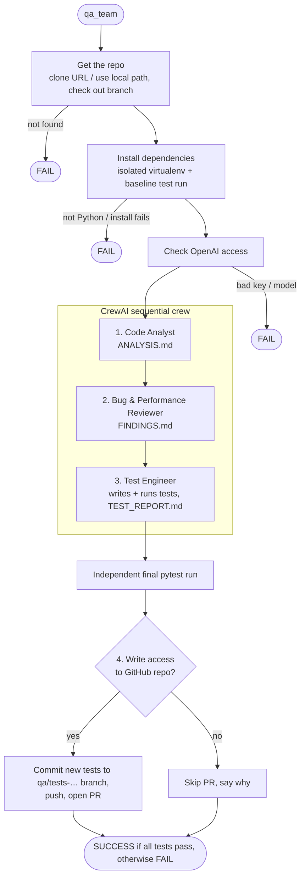

# QA Team Workflow

This document describes what happens between entering a repository and
getting the final **SUCCESS** / **FAIL** result. For setup and usage, see the
[README](../README.md).

The team does four things, and only these four:

1. **Analyze** the code
2. **Find** bugs and optimization opportunities
3. **Write, run and report on** a test suite
4. **Open a pull request** with the new tests, if you have write access to the repo

## At a glance



## What you see

By default, the terminal shows only one line per stage and the result:

```
[1/6] Getting https://github.com/owner/repo ... on branch main (2s)
[2/6] Installing dependencies ... existing tests: 96 passed (21s)
[3/6] Analyzing the code ... done (1m 05s)
[4/6] Looking for bugs and optimizations ... done (1m 40s)
[5/6] Writing and running tests ... done (3m 12s)
[6/6] Creating a pull request ... created (6s)

SUCCESS  https://github.com/owner/repo @ main
  All tests pass.
  Tests:    118 passed  (before: 96 passed; 2 new test file(s))
  PR:       https://github.com/owner/repo/pull/12
  Reports:  output/repo/
```

The agents' detailed step-by-step output goes to `output/<repo>/run.log`. Run
with `-v` / `--verbose` to see it live instead.

## Preparation (before the agents)

These steps are plain code (no LLM), so they're fast and cost nothing.

### Getting the repo (`repo_source.py`)

| Input | What happens |
|-------|--------------|
| `https://github.com/owner/repo` | Fresh clone into `workspace/repo`, then check out `--branch` if given |
| `https://github.com/owner/repo/pull/42` | Clone, then fetch and check out the PR's code (no PR is created in step 4 for this input) |
| `~/code/my-project` | Used in place, then check out `--branch` if given |

The checked-out branch is the one that gets analyzed, and it's also the branch
a step-4 pull request targets.

### Installing dependencies (`repo_env.py`)

1. Stop with FAIL if the repo has no Python code. Only Python/pytest repos are
   supported.
2. Find where the tests live: `testpaths` in `pyproject.toml`, otherwise an
   existing `tests/` or `test/` folder, otherwise a new `tests/` folder. pytest
   runs from the nearest project folder above it (for example `backend/`).
3. Create a fresh virtualenv at `workspace/.venvs/<repo>` and install:
   - the project, including its test/dev extras and dependency groups
   - any `requirements*.txt` files
   - pytest
4. Run the existing tests once to get a **baseline** (for example
   "96 passed"). The Test Engineer is told this result.

`qa_team <repo> --setup-only` stops here. It needs no API key.

## Steps 1–3: the crew (`crew.py`, `config/*.yaml`)

The three agents run one after another. Each task receives the earlier tasks'
outputs as context.

| Step | Agent | Tools | What it does | Report |
|------|-------|-------|--------------|--------|
| 1 | Code Analyst | list files, read file | Reads the layout, README, config and core modules. Describes the architecture, the existing tests and the risky areas. | `ANALYSIS.md` |
| 2 | Bug & Performance Reviewer | list files, read file | Reviews the source for logic errors, edge cases, security holes, leaks, concurrency problems and slow code. Each finding gets `path:line`, severity and a concrete fix. | `FINDINGS.md` |
| 3 | Test Engineer | list, read, write test file, run tests | Writes tests that reproduce the step-2 bugs and cover core behaviour, then runs them. It fixes *broken* tests but keeps tests that fail because of *real bugs*. Reports the results. | `TEST_REPORT.md` |

`TEST_REPORT.md` has these sections: Result (exact counts), Test Files,
Confirmed Bugs (failing tests that reproduce a finding), Unconfirmed Findings,
and Coverage Gaps.

### What agents can and can't do

- **Source code is never modified.** No agent has a tool that can edit it.
- **New test files only.** The Test Engineer can create new files inside the
  tests folder and rewrite files it created itself. It can't modify any
  existing file there, including existing tests and `conftest.py`.
- **Tests run in the repo's virtualenv,** from the detected project folder,
  with a 300-second timeout.
- **Paths are checked:** any path that resolves outside the repository is
  rejected.

## Verdict

After the crew finishes, the program runs the test suite once more **itself**
and decides the result from pytest's real exit code, never from what the LLM
claims.

| Situation | Result |
|-----------|--------|
| All tests (existing + new) pass | **SUCCESS** |
| Some tests fail | **FAIL**: often the new tests reproduced real bugs; see `TEST_REPORT.md` |
| No runnable tests | **FAIL** |
| Repo not found, install failed, bad API key, crew crashed | **FAIL** with the specific error |

## Step 4: pull request (`publish.py`)

This step is plain code, not an agent, so pushing to GitHub never depends on a
model's judgment.

1. **Check write access.** The `origin` remote must be on GitHub, the `gh` CLI
   must be logged in, and the logged-in account must have push permission
   (`gh api repos/OWNER/REPO` → `permissions.push`). If any of these fail, the
   step is skipped and the reason is printed, for example
   `skipped: professor-jo has no write access to d3jo/Travel-Planner`.
2. **Commit only the new test files** the Test Engineer created, on a new
   branch `qa/tests-YYYYMMDD-HHMMSS`. Nothing else in the working tree is
   committed.
3. **Push** using your `gh` login.
4. **Open a PR** into the branch that was tested:
   - Title: "QA: add test suite", with "(failing tests reproduce bugs)" added
     if any tests fail.
   - Body: the test result, the list of new files, and the test and findings
     reports (in collapsible sections).
5. **Switch back** to the tested branch.

A PR is still opened when tests fail, because failing tests that reproduce bugs
are the useful part. Use `--no-pr` to skip this step entirely. Nothing is ever
merged automatically.

## Outputs

| What | Where |
|------|-------|
| Code analysis | `output/<repo>/ANALYSIS.md` |
| Bugs & optimizations | `output/<repo>/FINDINGS.md` |
| Test report | `output/<repo>/TEST_REPORT.md` |
| Full agent log | `output/<repo>/run.log` |
| New test files | the detected tests folder in the checkout, and in the PR |
| Pull request | printed in the result line `PR:` |
| Exit code | `0` success, `1` failure, `130` cancelled |

## Configuration

| Setting | Where | Default |
|---------|-------|---------|
| `OPENAI_API_KEY` | `.env` | (required) |
| `MODEL` | `.env` | `gpt-5-mini` |
| `TEMPERATURE` | `.env` | unset (gpt-5 models only accept the default) |
| GitHub account used for PRs | `gh auth switch` | the active `gh` account |
| Agent prompts | `config/agents.yaml`, `config/tasks.yaml` | — |

## Known limitations

- Python/pytest repos only.
- System-level dependencies (database servers, native libraries) aren't installed.
- Remote repos are re-cloned on every run, so generated tests that weren't
  pushed in a PR are lost on the next run (copy them out first).
